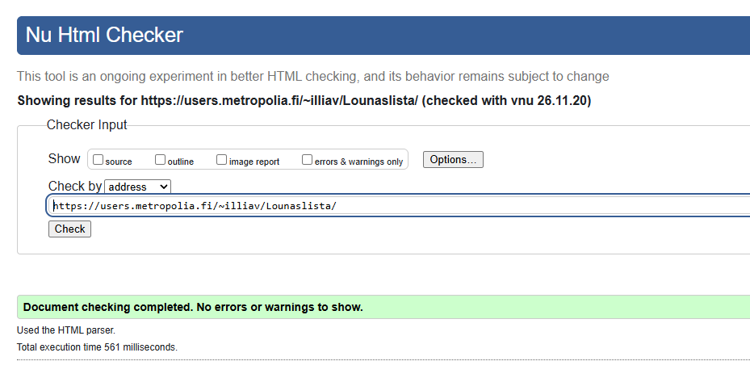
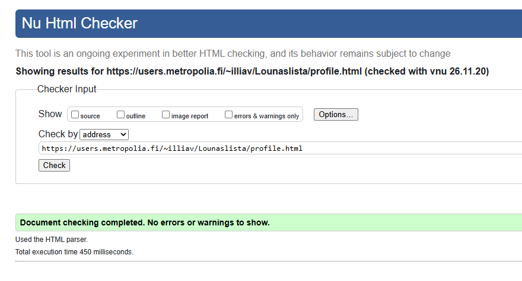
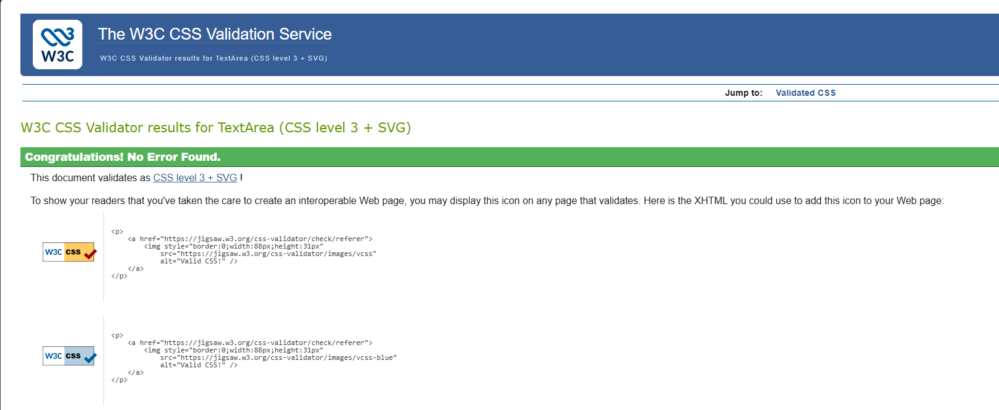
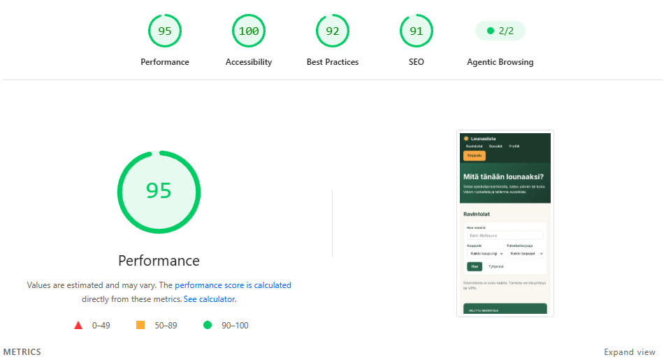

# Lounaslista

[Avaa Lounaslista](https://users.metropolia.fi/~illiav/Lounaslista/)

Lounaslista on toteutettu osana korkeakouluopintoja Web-sovelluskehitys-kurssilla. Sovelluksen käyttöliittymä on tehty HTML:llä, CSS:llä ja vanilla JavaScriptillä (ES6+) ilman JavaScript-kehystä. Interaktiivisessa kartassa käytetään Leaflet-kirjastoa.

## Ominaisuudet

- Opiskelijaravintoloiden selaaminen sekä päivän ja viikon ruokalistojen katselu.
- Ravintoloiden haku ja suodatus nimen, kaupungin ja palveluntarjoajan mukaan.
- Rekisteröityminen, kirjautuminen ja suosikkiravintolan tallentaminen.
- Profiilitietojen muokkaaminen ja profiilikuvan lataaminen.
- Ravintoloiden tarkastelu kartalla ja lähimmän ravintolan etsiminen käyttäjän sijainnin avulla.

## Validoinnit ja kuvakaappaukset

### HTML-validointi

### CSS-validointi

### Lighthouse-tarkistus

## Tulevaisuuden parannukset

- Laajentaa sovelluksen ominaisuuksia ja käyttömahdollisuuksia
- Lisätä sovellukseen **Poista tili** -painikkeen
- Tehdä sovelluksesta itsenäinen versio, joka voi ladata puhelimeen ja käyttää suoraan mistä tahansa paikasta.
